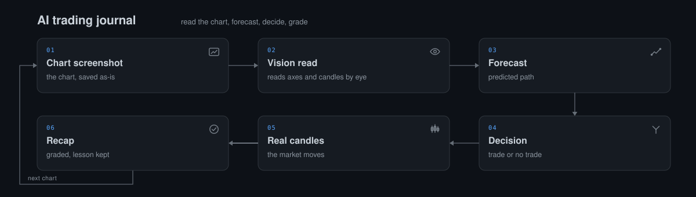
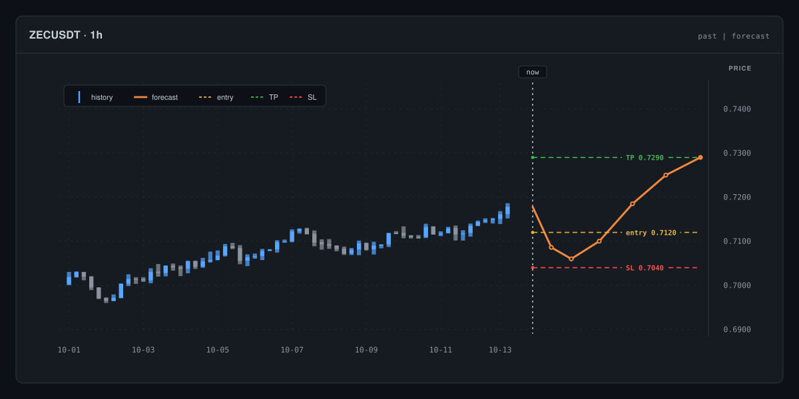
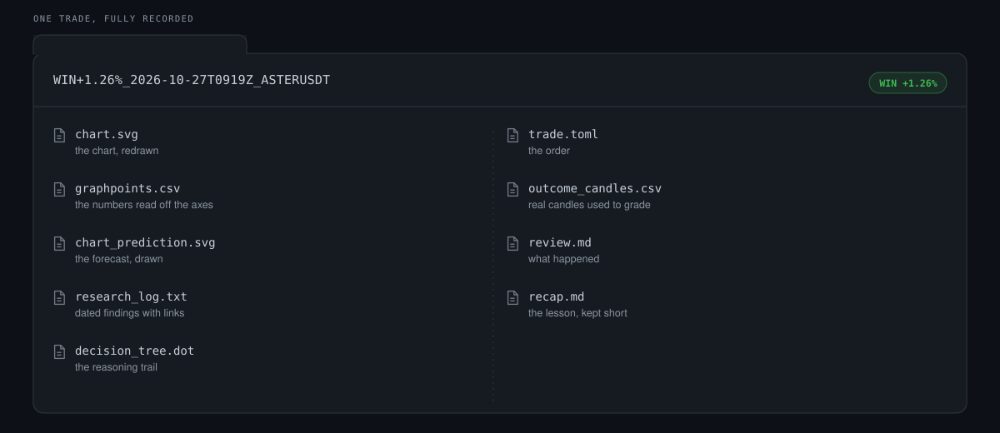

# AI trading journal

A mock trading journal where an AI reads your chart screenshot, predicts where the price might go, decides whether a trade is worth taking, and writes it all down so you can see later whether it was right.

This is a practice journal only. No money and no exchange are involved, and nothing here is financial advice.



You take a screenshot, the AI reads it and makes a call, the trade is written into a folder, and later the real market prices decide whether it worked.

## What it is

This is a journal, not a trading bot. You give an AI a picture of a chart, and it reads the prices and levels with its own eyes, sketches where it thinks the price will go, and says whether a trade is justified. If it says yes, it records the trade in a folder with everything it thought along the way. Days later, the real price is fetched and the trade is graded against what actually happened. It is a way to test how well you (and the AI) read charts and make decisions. It is not a money printer, and a good result here is a sign of clear thinking, nothing more.

## See it



The AI draws its forecast on a second chart, so you can compare its guess with what the price really did.



Every trade is its own folder, named after its status, with the chart, the numbers, the notes and the outcome inside.

## Try it in five minutes

You do not need to install anything or know any commands. You need a chart picture and an AI that can see images.

1. **Get a chart picture.** Open TradingView or any other charting site, pick a coin or a stock, and take a screenshot of the chart. Note the timeframe (for example one hour, or one day) so you can tell the AI.

2. **Point the AI at the manual.** Open an AI agent that can look at images, write files and run commands — Claude Code and Codex CLI are two everyday examples. Give it the file `agent/manual/trading-journal.md`. It is a plain markdown file that comes with the repository, not a plugin and nothing to install, and it tells the AI exactly how to keep this journal. Paste the starter prompt below with your screenshot attached.

3. **Look at the result.** The AI creates a folder under `trades/` holding the chart redrawn, the points it read off it, its forecast in a second chart, its research notes and its decision. After the time you gave the trade has passed, the same folder is graded against the real price.

Copy this starter prompt, attach your screenshot, and send it:

```text
Read the file agent/manual/trading-journal.md and follow it exactly.
The chart image attached to this message is my screenshot for a new trade.
Read the chart yourself and note the symbol, the timeframe, and every level you can actually see.
Forecast where the price is likely to go, then decide whether a trade is worth taking, and say why.
If it is, create the trade folder under trades/ and fill in every file the skill asks for. If it is not, write down why you passed.
```

## What you get back

- The chart redrawn by the AI, so you can see whether it looked at the same picture you did.
- The numbers it read off the axes, written down as it saw them.
- Its forecast, drawn on a second chart over the first, so the guess is visible rather than hidden in words.
- Its reasoning trail: the research notes and the decision tree that led to the call.
- The trade itself, stored in a folder whose name states the status, for example `PENDING_2026-10-19T0900Z_BTCUSDT` before the outcome and `WIN+5.32%_2026-10-19T0900Z_BTCUSDT` after it.
- A written post-mortem once the real price has been checked, so each trade ends with a lesson.

## How the grading works

- The AI makes the decisions. The scripts only do the measuring.
- The outcome is worked out from real market prices by a fixed rule that the AI cannot bend, so the AI never grades its own homework.
- A win does not prove the thinking was good, and a loss does not prove it was bad. Luck is real, especially on a single trade.
- Results are the price move on one unit, with no leverage, added up across trades. No compounding, no clever accounting.
- A limit order counts as filled when the price touches your level. A market order counts as filled at the next candle's open.
- Take-profit and stop-loss count as filled when the price touches them. If one candle touches both, it counts as a loss.

## FAQ

### Is this real money?

No. Nothing is ever sent to an exchange. Trades are written into folders on your computer and graded on paper.

### Do I need to know how to code?

No. If you can take a screenshot and paste a message to an AI, you can use this. The scripts run when the AI runs them for you.

### My AI says the skill is "not assigned" — is something broken?

No. The manual is an ordinary markdown file in the repository, not a plugin your AI has to be granted access to. Some AI tools reserve the word "skill" for things they manage themselves, and then look for the manual in the wrong place. Tell it: "read the file `agent/manual/trading-journal.md` directly with cat" and it will carry on.

### Do I need a paid API key?

No. The scripts are plain Python 3.8 or newer with nothing extra to install, and the AI does the chart reading itself.

### Which charts can I use?

Any chart you can screenshot: crypto, stocks, forex, any market and any timeframe. Just tell the AI what you are showing it.

### How do I know the AI is not cheating or making the numbers up?

By rule, the AI reads charts with its eyes only. It is not allowed to trace the image in code, read the text off it with OCR, or adjust its numbers to match market data afterwards. If real market data later shows a level was read slightly wrong, the correction has to go into the log with both values visible side by side, so you can always see what changed and when.

### What if the AI cannot read a level precisely?

Then it has to say so: give a zone rather than a single number, or admit it cannot tell. A vague number presented as exact is a mistake, not a reading.

## Under the hood

<details>
<summary>For developers and the curious</summary>

The AI works through the same steps every time:

1. Read the screenshot with vision only and record what it can see.
2. Redraw the chart to prove the reading.
3. Mark the levels and the structure it found.
4. Write a research log and a decision tree.
5. Write a forecast price path and draw it on a second chart.
6. Decide whether a trade is justified, and record the trade if so.
7. Wait for the trade to expire.
8. Resolve it against real candles and write the review.

The five scripts, all plain Python 3.8+ with no dependencies:

| Script | What it does |
| --- | --- |
| `new_trade.py` | Creates a trade folder and its starter files |
| `set_status.py` | Moves a folder from one status to another |
| `finalize.py` | Turns a finished decision into a recorded trade: it writes the trade record, renames the folder to PENDING or OPEN, and refuses numbers that do not add up |
| `resolve_expired.py` | Grades expired trades against real candles and writes the review |
| `stats.py` | Adds up the results across all trades |

A trade folder holds nine files: `chart.svg`, `graphpoints.csv`, `chart_prediction.svg`, `research_log.txt`, `decision_tree.dot`, `trade.toml`, `outcome_candles.csv`, `review.md` and `recap.md`.

- `agent/manual/trading-journal.md` is the operating manual. It is self-sufficient: give the AI this and nothing else and it can run a trade end to end.
- `agent/system_prompt.md` sets out the analyst's stance. It is optional, and only shapes tone and scepticism.

</details>

## Contributing

Ideas, chart-reading improvements and clearer wording are all welcome. Open an issue or a pull request and explain what you tried.

## Licence

Apache 2.0.
